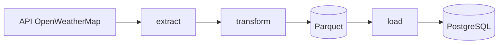
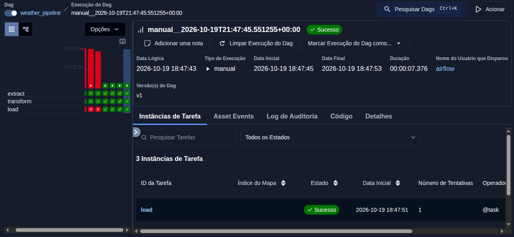

# Weather Pipeline

Pipeline de dados (ETL) que coleta o clima atual do Rio de Janeiro na API da OpenWeatherMap, transforma os dados com Pandas e grava em um banco PostgreSQL. A execução é orquestrada pelo Apache Airflow, rodando a cada hora dentro do Docker.

## Fluxo



1. **extract:** consulta a API e obtém os dados do clima do Rio de Janeiro.
2. **transform:** limpa e organiza os dados com Pandas e salva em Parquet.
3. **load:** lê o Parquet e grava na tabela `rj_weather` do PostgreSQL.

A DAG se chama `weather_pipeline` e executa de hora em hora.

## Tecnologias

- Python e Pandas
- Apache Airflow 3 (CeleryExecutor)
- Docker e Docker Compose
- PostgreSQL
- uv (gerenciador de dependências)

## Estrutura

```
.
├── dags/                    # DAG do Airflow (weather_dag.py)
├── src/pipeline_weather/    # extract_data.py, transform_data.py, load_data.py
├── notebooks/               # análises exploratórias
├── config/                  # configurações locais (.env não é versionado)
├── docker-compose.yaml
├── main.py
└── pyproject.toml
```

## Como rodar

Pré-requisitos: Docker com Docker Compose e uma chave gratuita da [OpenWeatherMap](https://openweathermap.org/api).

**1. Clone o repositório**

```bash
git clone https://github.com/JonatasF-Alves/weather_pipeline.git
cd weather_pipeline
```

**2. Crie os arquivos de variáveis**

```bash
cp .env.example .env
cp .env.example config/.env
mkdir -p data
```

Edite os dois arquivos e preencha `API_KEY`, `DB_USER` e `DB_PASSWORD`. No Linux, coloque em `AIRFLOW_UID` o resultado de `id -u`.

**3. Suba os containers**

```bash
docker compose up -d
```

A primeira subida pode levar alguns minutos, porque baixa as imagens e instala as bibliotecas.

**4. Crie o usuário e o banco (só na primeira vez)**

Troque `seu_usuario` e `sua_senha` pelos mesmos valores do `.env`:

```bash
docker compose exec postgres psql -U airflow -c "CREATE USER seu_usuario WITH PASSWORD 'sua_senha';"
docker compose exec postgres psql -U airflow -c "CREATE DATABASE weather OWNER seu_usuario;"
```

**5. Execute a DAG**

1. Abra http://localhost:8080 e entre com `airflow` / `airflow`.
2. Procure a `weather_pipeline`, ative-a e clique em **Trigger**.
3. Aguarde as três tasks ficarem verdes.

**6. Confira os dados**

```bash
docker compose exec postgres psql -U seu_usuario -d weather -c "SELECT * FROM rj_weather LIMIT 5;"
```

Para parar tudo: `docker compose down`.

## Screenshots

<<Coloque aqui a imagem da DAG com as tasks verdes>>



## Próximos passos

- Análises e dashboard sobre a tabela `rj_weather`
- Testes automatizados para a etapa de transformação
- Criação automática do usuário e do banco na inicialização

## Autor

Jonatas Fernandes Alves · [GitHub](https://github.com/JonatasF-Alves)